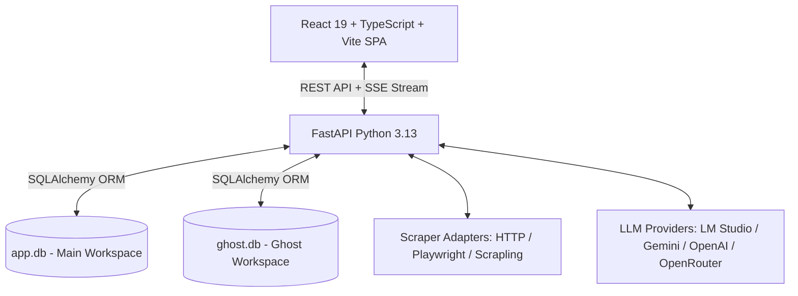
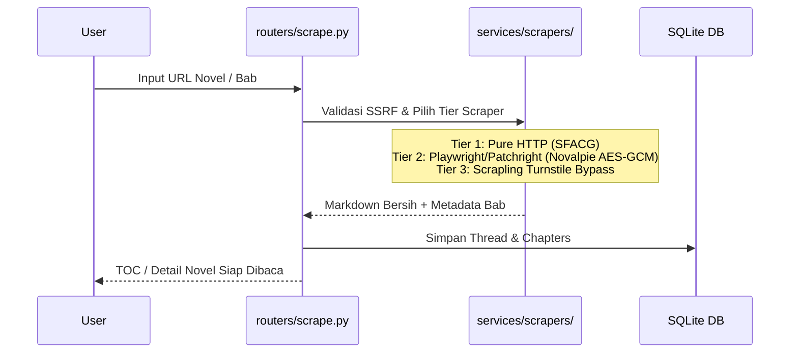
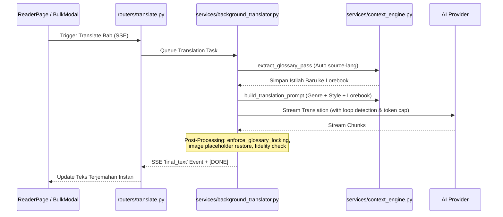
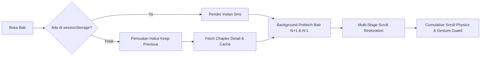

# ReadOmni AI (Translator Web) — Architecture Overview & Entry Points

Dokumen ini adalah ringkasan arsitektur tingkat tinggi sebagai pintu masuk bagi developer dan AI Agent baru.

---

## 🏛️ 1. Arsitektur Sistem

ReadOmni AI mengadopsi arsitektur terpisah antara antarmuka modern (Client-Side SPA) dan pemrosesan latar belakang berkinerja tinggi (Backend Service):

### Komponen Utama:
1. **Frontend (`src/`)**:
   - Single Page Application berbasis **React 19**, **TypeScript 5.8 (Strict)**, dan **Vite**.
   - Komponen UI dibangun dengan **Tailwind CSS**, **Lucide React**, dan **Radix UI / Material UI**.
   - Integrasi cache sisi klien menggunakan `sessionStorage` (Stale-While-Revalidate) dengan isolasi workspace via `getWorkspaceStorageKey()`.

2. **Backend (`backend/`)**:
   - Web framework asinkron menggunakan **FastAPI** dengan dependency injection dan event streaming SSE (Server-Sent Events).
   - Data layer menggunakan **SQLAlchemy** dengan dual-database SQLite (`app.db` untuk perpustakaan utama, `ghost.db` untuk private vault).
   - Multi-Tenancy Invariant diatur secara terpusat melalui `normalize_workspace` dan `make_workspace_key`.

---

## 🔄 2. Tiga Alur Data Inti (Core Data Flows)

### A. Alur Ingestion & Web Scraping

### B. Alur Ekstraksi Konteks & Terjemahan

### C. Alur Pengalaman Membaca (Reader UX)

---

## 🚪 3. Titik Masuk Penting (Key Entry Points)

| Modul | Path File | Tanggung Jawab Utama |
|---|---|---|
| **Backend Entry** | `backend/main.py` | Registrasi router FastAPI, inisialisasi database, middleware CORS & workspace. |
| **Database Models** | `backend/database.py` | Definisi schema tabel, helper compound tenancy (`make_workspace_key`), auto-migration `init_db`. |
| **Context & Glossary** | `backend/services/context_engine.py` | Perakitan prompt terjemahan, ekstraksi lorebook, penguncian glosarium, deteksi bahasa sumber. |
| **Background Translator** | `backend/services/background_translator.py` | Antrean batch worker, pacing provider, lock per workspace, deteksi loop repetisi LLM. |
| **Frontend Entry** | `src/App.tsx` | State navigasi tab aplikasi, sesi aktif, dan rendering layout utama. |
| **API Client** | `src/lib/api.ts` | Wrapper fetch dengan injeksi header `X-Workspace` dan generator key storage workspace. |
| **Library Page** | `src/pages/LibraryPage.tsx` | Rak buku visual, SWR cache, filter kategori, cover generator. |
| **Reader Page** | `src/pages/ReaderPage.tsx` | Orkestrasi mode baca, prefetch bab bersebelahan, dialog kontrol chapter. |
| **Reader Component** | `src/components/reader/ChapterReader.tsx` | Fisika scroll anti-mental, Quick Chapter Drawer TOC, render teks split. |
